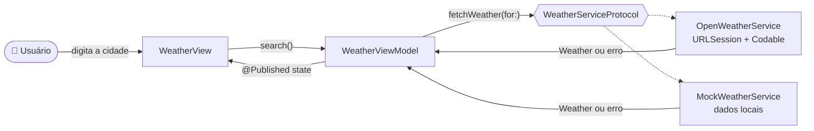
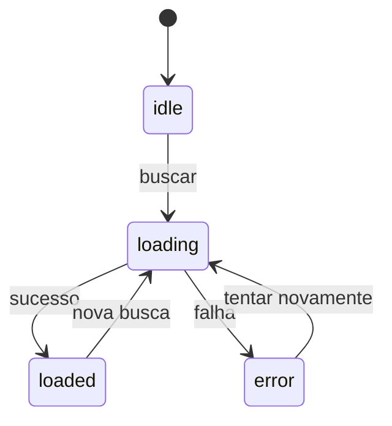

<div align="center">


# WeatherApp

**Aplicativo iOS de clima feito em SwiftUI com arquitetura MVVM**

Busque qualquer cidade e veja a temperatura atual, a condição do tempo e um ícone correspondente, com dados em tempo real da OpenWeatherMap.


</div>

---

## 📱 Telas

| Início | Resultado | Erro |
|:---:|:---:|:---:|
| |||
 

---

## ✨ Funcionalidades

- 🔎 Busca de cidades pela barra de pesquisa nativa do iOS (`.searchable`)
- 🌡️ Temperatura atual em **Celsius**, sensação térmica e umidade
- ☁️ Descrição do tempo em **português**, com ícone **SF Symbols** que muda conforme a condição e entre dia e noite
- ⏳ Indicador de **carregando** durante a requisição
- ⚠️ **Tratamento de erros** com mensagens amigáveis (cidade não encontrada, sem internet, API Key inválida) e botão de *tentar novamente*
- 🎨 Ícone próprio com versões para **modo claro e escuro**
- 🧪 **Modo Mock**, que permite rodar o app sem internet e sem API Key

---

## 🏗️ Arquitetura

O projeto segue o padrão **MVVM (Model-View-ViewModel)**, e cada camada tem uma única responsabilidade:

| Camada | Responsabilidade | Arquivos |
|---|---|---|
| **Model** | Representa os dados. Um modelo espelha o JSON da API e o outro é o modelo limpo usado pelo app. | `WeatherResponse.swift`, `Weather.swift` |
| **Service** | Faz a requisição HTTP com `URLSession` e converte o JSON com `Codable`. | `WeatherService.swift` |
| **ViewModel** | Guarda o estado da tela e recebe as ações do usuário. Não conhece SwiftUI. | `WeatherViewModel.swift` |
| **View** | Apenas desenha o estado que recebe. Não conhece rede nem JSON. | `WeatherView.swift`, `Components/` |

### Fluxo de dados



### Estados da tela

Todos os estados possíveis ficam em um único `enum`. Assim, combinações impossíveis (como *carregando e com erro ao mesmo tempo*) não podem acontecer:

```swift
enum ViewState: Equatable {
    case idle               // nenhuma busca ainda
    case loading            // aguardando a API
    case loaded(Weather)    // sucesso
    case error(String)      // falha, com mensagem para o usuário
}
```



---

## 🧠 Decisões técnicas

**1. Injeção de dependência via protocolo**
A ViewModel depende de `WeatherServiceProtocol`, e não de uma implementação concreta. A mesma ViewModel funciona com a API real, com o Mock (previews e desenvolvimento offline) e futuramente com dublês em testes unitários.

**2. Separação entre modelo da API e modelo do app**
`WeatherResponse` reflete o formato do JSON. `Weather` reflete o que a interface precisa, como a temperatura formatada e o nome do ícone. Se a API mudar ou for trocada, só o mapeamento muda e as Views continuam iguais.

**3. `async/await` em vez de closures**
A requisição usa `try await URLSession.shared.data(from:)`, o que deixa o código linear e fácil de ler. A ViewModel é marcada com `@MainActor` para garantir que a interface só seja atualizada na thread principal.

**4. `ObservableObject` + `@Published` + `@StateObject`**
O macro `@Observable` exige iOS 17. Para manter a compatibilidade com o **iOS 16**, o projeto usa o padrão `ObservableObject`. A View usa `@StateObject` porque é dona da ViewModel e precisa mantê-la viva entre redesenhos.

**5. Compatível com as regras novas do Xcode 26**
O Xcode 26 exige que cada arquivo importe explicitamente os módulos que usa (*Member Import Visibility*) e isola o código no `MainActor` por padrão. Por isso a ViewModel faz `import Combine`, de onde vêm o `ObservableObject` e o `@Published`, e cria o service dentro do `init`, e não como valor padrão do parâmetro.

**6. Erros tipados e mensagens amigáveis**
`WeatherError` traduz os status HTTP (401, 404 etc.) e as falhas de rede em mensagens claras para o usuário, usando `LocalizedError`.

**7. API Key fora do repositório**
A chave fica em `Secrets.swift`, que está no `.gitignore`. O arquivo `Secrets.example.swift` mostra como configurá-la.

**8. Zero dependências externas**
O app usa apenas frameworks nativos da Apple: SwiftUI, Foundation, Combine e SF Symbols.

---

## 📂 Estrutura do projeto

```
WeatherApp/
├── README.md
├── .gitignore
├── docs/                                # Ícone e prints usados neste README
├── WeatherApp.xcodeproj
└── WeatherApp/
    ├── WeatherAppApp.swift              # Ponto de entrada (@main)
    ├── Assets.xcassets/                 # AppIcon (claro/escuro) e logo
    ├── Config/
    │   ├── Secrets.example.swift        # Modelo de configuração (versionado)
    │   └── Secrets.swift                # Sua API Key (ignorado pelo Git)
    ├── Models/
    │   ├── WeatherResponse.swift        # Espelho do JSON da API (Decodable)
    │   └── Weather.swift                # Modelo usado pela interface
    ├── Services/
    │   └── WeatherService.swift         # Protocolo, API real, Mock e erros
    ├── ViewModels/
    │   └── WeatherViewModel.swift       # Estado da tela e lógica de busca
    └── Views/
        ├── WeatherView.swift            # Tela principal
        └── Components/
            ├── WeatherCardView.swift    # Cartão com o clima
            └── StateViews.swift         # Telas inicial (com logo) e de erro
```

---

## 🚀 Como rodar

### Pré-requisitos
- macOS com **Xcode 16** ou superior (testado no Xcode 26)
- Simulador ou iPhone com **iOS 16** ou superior

### Passo a passo

1. **Clone o repositório**
   ```bash
   git clone https://github.com/SEU_USUARIO/WeatherApp.git
   cd WeatherApp
   ```

2. **Configure a API Key**
   - Crie uma conta gratuita em [openweathermap.org](https://openweathermap.org/api) e copie sua chave em *My API keys*.
   - Copie o arquivo de exemplo:
     ```bash
     cp WeatherApp/Config/Secrets.example.swift WeatherApp/Config/Secrets.swift
     ```
   - Abra o `Secrets.swift`, descomente o código e cole sua chave.

   > ⚠️ Chaves novas podem levar algumas horas para serem ativadas. Enquanto isso, o app mostra *"API Key inválida"*. Use o modo Mock até lá.

3. **Rode o projeto**
   Abra o `WeatherApp.xcodeproj`, escolha um simulador e pressione `⌘ + R`.

### Rodando sem API Key (modo Mock)

No `WeatherAppApp.swift`, troque o service:

```swift
WeatherView(service: MockWeatherService())
```

Digite qualquer cidade para ver dados de exemplo, ou digite **`erro`** para ver a tela de erro.

---

## 🛠️ Problemas comuns

| Sintoma | Solução |
|---|---|
| `Type 'WeatherViewModel' does not conform to protocol 'ObservableObject'` | Confirme que o `WeatherViewModel.swift` tem `import Combine` no topo. |
| `Cannot find 'Secrets' in scope` | O `Secrets.swift` não existe ou está fora do target. Crie o arquivo (passo 2) e marque **WeatherApp** em *Target Membership*. |
| Ícone do app aparece em branco/quadriculado | Apague o app do simulador, faça **Clean Build Folder** (`⌘ + Shift + K`) e rode de novo. O iOS guarda o ícone antigo em cache. |
| Logo não aparece na tela inicial | No Assets, o Image Set precisa se chamar exatamente `logo`. |
| *"API Key inválida"* | A chave ainda não foi ativada. Aguarde algumas horas ou use o modo Mock. |

---

## 🔌 API utilizada

[OpenWeatherMap – Current Weather Data](https://openweathermap.org/current)

```
GET https://api.openweathermap.org/data/2.5/weather
    ?q={cidade}&appid={chave}&units=metric&lang=pt_br
```

| Parâmetro | Função |
|---|---|
| `units=metric` | Temperatura em Celsius |
| `lang=pt_br` | Descrição do tempo em português |

---

## 🗺️ Próximos passos

- [ ] Testes unitários da `WeatherViewModel` usando o `MockWeatherService`
- [ ] Previsão para os próximos 5 dias
- [ ] Clima da localização atual com `CoreLocation`
- [ ] Salvar cidades favoritas
- [ ] Fundo dinâmico conforme a condição e o horário
- [ ] Migração para `@Observable` quando o suporte mínimo for iOS 17

---

## 👨‍💻 Autor

**Fernando**, estudante de Sistemas de Informação na FIAP.

[](https://www.linkedin.com/in/fernando-kang/)
[](https://github.com/fykwork9926)

---

<sub>Dados climáticos fornecidos por [OpenWeatherMap](https://openweathermap.org/).</sub>
